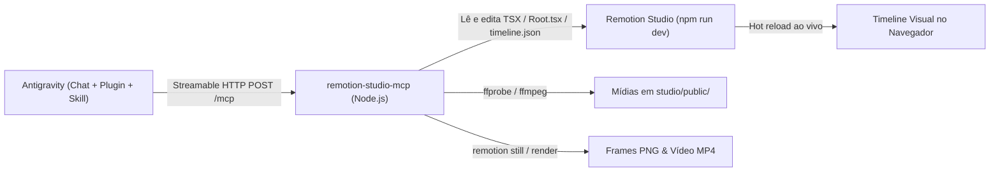

<p align="center">
  
  &nbsp;&nbsp;&nbsp;&nbsp;&nbsp;
  
</p>

<h1 align="center">Remotion Studio MCP — Plugin &amp; Skill para Antigravity</h1>

<p align="center">
  Conecte o <strong>Antigravity</strong> diretamente ao seu projeto <strong>Remotion Studio</strong> (local ou em um servidor remoto via <strong>Streamable HTTP MCP</strong>) para inspecionar mídias, editar composições <code>.tsx</code>, controlar uma timeline orientada a dados (<code>TimelineEditor</code>), capturar frames e renderizar vídeos direto no SSD onde o Remotion está rodando.
</p>

<p align="center">
  
  
  
  
  
</p>

---

## Arquitetura



### Por que usar essa arquitetura?
- **Zero tráfego de vídeo na rede:** se o Remotion roda em um servidor Linux/homeserver, `ffprobe`, `ffmpeg`, `remotion still` e `remotion render` rodam direto no SSD do servidor.
- **Edição completa de qualquer composição:** funciona tanto criando/editando arquivos `.tsx` e `src/Root.tsx` quanto via `timeline.json` na composição `TimelineEditor`.
- **Feedback visual real:** o agente usa `extract_frames` antes de cortar e `capture_frame` (`remotion still`) para enxergar o frame renderizado antes de finalizar.
- **Um comando só (`npm run dev`):** o launcher `dev.mjs` inicia o servidor MCP e o Remotion Studio juntos (sem conflito de porta caso o MCP já esteja ativo em segundo plano).

---

## Estrutura do Repositório

```text
remotion-studio-mcp-plugin/
├── README.md
├── LICENSE
├── .gitignore
├── mcp-server/                     # Servidor MCP Streamable HTTP (Node.js + Zod)
│   ├── package.json
│   ├── .env.example
│   └── src/
│       ├── server.js               # 21 ferramentas MCP (/mcp e /health)
│       └── timelineSchema.js       # Schema Zod compartilhado da timeline
├── plugin/                         # Plugin completo para o Antigravity
│   ├── plugin.json
│   ├── mcp_config.example.json     # Copie para mcp_config.json e ajuste a URL
│   ├── rules/
│   │   └── AGENTS.md               # Regras carregadas quando o plugin está ativo
│   └── skills/
│       └── remotion-studio-mcp/
│           └── SKILL.md            # Workflow detalhado usando as tools MCP
├── skills/                         # Skill standalone (sem depender do MCP remoto)
│   └── remotion-video-editor/
│       └── SKILL.md
└── studio-template/                # Arquivos opcionais para adicionar ao seu projeto Remotion
    ├── scripts/
    │   └── dev.mjs                 # Sobe MCP + Remotion Studio juntos no npm run dev
    └── src/
        ├── TimelineEditorComposition.tsx
        ├── Root.example.tsx
        └── data/
            ├── timelineSchema.ts
            └── timeline.example.json
```

---

## Pré-requisitos

- **Node.js 20 LTS ou 22 LTS** *(recomendado — recursos modernos do Remotion e `@clack/prompts` usam `node:util` `styleText` e `globalThis.crypto`)*
- **FFmpeg** e **ffprobe** instalados no `PATH` da máquina onde o Remotion roda
- Projeto **Remotion 4.x** (ex.: criado com `npx create-video@latest studio`)

---

## Instalação Passo a Passo

### 1. Configurar o Servidor MCP junto ao seu projeto Remotion

Supondo uma pasta raiz com `studio/` (seu projeto Remotion) e `mcp-server/`:

```bash
cp -r mcp-server /caminho/para/Remotion/mcp-server
cd /caminho/para/Remotion/mcp-server
cp .env.example .env
npm install
```

Edite o `.env` se precisar customizar porta ou pastas:

```env
PORT=3333
HOST=0.0.0.0
STUDIO_DIR=../studio
EXPORT_DIR=../studio/exports
# Opcional: diretório externo permitido para importar mídias (ex.: pasta montada do Drive)
IMPORT_ROOT_DIR=
```

Teste subindo o servidor:

```bash
npm start
# Verifique no navegador ou curl:
# http://localhost:3333/health
```

> **Dica:** para rodar com o comando único `npm run dev` dentro de `studio/`, copie `studio-template/scripts/dev.mjs` para `studio/scripts/dev.mjs` e ajuste o `package.json` do `studio`:
> ```json
> "scripts": {
>   "dev": "node scripts/dev.mjs",
>   "start": "node scripts/dev.mjs",
>   "studio": "remotion studio"
> }
> ```

---

### 2. (Opcional) Adicionar a composição `TimelineEditor` ao seu Remotion

Se quiser usar também as ferramentas rápidas de timeline JSON (`upsert_clip`, `upsert_text`, `upsert_audio_track`, `set_color_grade`):

1. Copie `studio-template/src/TimelineEditorComposition.tsx` para `studio/src/`.
2. Copie `studio-template/src/data/timelineSchema.ts` e `timeline.example.json` (como `timeline.json`) para `studio/src/data/`.
3. Registre `<Composition id="TimelineEditor" ... />` no `studio/src/Root.tsx` conforme mostrado em `studio-template/src/Root.example.tsx` (ative `"resolveJsonModule": true` no `tsconfig.json`).

---

### 3. Instalar o Plugin e a Skill no Antigravity

Copie a pasta `plugin/` para o diretório global de plugins do Antigravity (`~/.gemini/config/plugins/remotion-studio-mcp/`):

**Linux / macOS:**
```bash
mkdir -p ~/.gemini/config/plugins
cp -r plugin ~/.gemini/config/plugins/remotion-studio-mcp
cp ~/.gemini/config/plugins/remotion-studio-mcp/mcp_config.example.json \
   ~/.gemini/config/plugins/remotion-studio-mcp/mcp_config.json
```

**Windows (PowerShell):**
```powershell
New-Item -ItemType Directory -Force "$env:USERPROFILE\.gemini\config\plugins" | Out-Null
Copy-Item -Recurse .\plugin "$env:USERPROFILE\.gemini\config\plugins\remotion-studio-mcp"
Copy-Item "$env:USERPROFILE\.gemini\config\plugins\remotion-studio-mcp\mcp_config.example.json" `
          "$env:USERPROFILE\.gemini\config\plugins\remotion-studio-mcp\mcp_config.json"
```

Edite o `mcp_config.json` apontando para o endereço do servidor (local ou IP da sua rede/VPN):

```json
{
  "mcpServers": {
    "remotion-studio": {
      "url": "http://SEU_IP_OU_LOCALHOST:3333/mcp"
    }
  }
}
```

*(Opcional)* Para instalar também a skill standalone `remotion-video-editor` (útil quando você abre um workspace Remotion localmente sem o servidor MCP):

```bash
cp -r skills/remotion-video-editor ~/.gemini/config/skills/remotion-video-editor
```

Depois, recarregue os servidores MCP no Antigravity (**`... > MCP Servers`**) ou inicie uma nova conversa.

---

## Referência das 21 Ferramentas MCP

### Código & Composições (qualquer composição Remotion)
| Tool | Descrição |
|---|---|
| `list_project_files` | Lista arquivos em `studio/src/` ou subdiretórios |
| `read_project_file` | Lê arquivos `.tsx`, `.ts`, `.json` ou configs do projeto |
| `write_project_file` | Cria ou sobrescreve arquivos dentro de `studio/src/` |
| `edit_project_file` | Substitui trechos exatos em arquivos sem reescrever o arquivo todo |
| `create_composition` | Cria novo `.tsx` e registra `<Composition>` automaticamente em `src/Root.tsx` |
| `list_compositions` | Lista todas as composições registradas via Remotion CLI |
| `check_types` | Executa `tsc --noEmit` direto no servidor |

### Mídia, FFmpeg & Importação
| Tool | Descrição |
|---|---|
| `list_assets` | Lista vídeos, áudios e imagens em `studio/public/` |
| `import_media_from_drive` | Copia mídia de `IMPORT_ROOT_DIR` direto para `studio/public/` |
| `inspect_media` | Extrai duração, resolução, FPS e áudio com `ffprobe` |
| `extract_frames` | Gera folha de contato JPEG com `ffmpeg` para inspeção visual das cenas |

### `TimelineEditor` (Edição rápida via `timeline.json`)
| Tool | Descrição |
|---|---|
| `get_timeline` | Lê o estado atual de `src/data/timeline.json` |
| `set_timeline` | Substitui o JSON completo da timeline |
| `upsert_clip` / `remove_clip` | Adiciona, atualiza ou remove clipes da sequência |
| `upsert_text` / `remove_text` | Adiciona, atualiza ou remove textos minimalistas animados |
| `upsert_audio_track` | Configura trilha sonora com `volume`, `fadeInFrames` e `fadeOutFrames` |
| `set_color_grade` | Ajusta `brightness`, `contrast`, `saturate` e `vignette` |

### Visualização & Exportação
| Tool | Descrição |
|---|---|
| `capture_frame` | Executa `remotion still` para qualquer `compositionId` e retorna a imagem PNG |
| `render_video` | Executa `remotion render` (codec, CRF, range de frames e exportação para `EXPORT_DIR`) |

---

## Endpoints HTTP do Servidor MCP

- `GET /health` — retorna status, versão e caminhos configurados (`ok: true`)
- `POST /mcp` (e `GET` / `DELETE`) — endpoint oficial **Streamable HTTP** para clientes MCP *(retorna `Not Acceptable` se aberto direto no navegador comum, pois exige o header `Accept: text/event-stream`)*

---

## Licença

Distribuído sob a licença [MIT](LICENSE).
